 

<table>
  <tr>
    <td width="58%" valign="top">
      <h2>Acerca de mí</h2>
      
Soy <strong>Ingeniero en Desarrollo de Software</strong>, comprometido con el desarrollo de nuevos productos en las áreas de backend y frontend.

      
Poseo sólidos conocimientos en diversas plataformas y lenguajes de programación, con un enfoque constante en fortalecer mis habilidades técnicas y alcanzar la superación personal.

      
Me interesa aportar, mejorar y hacer más eficientes los desarrollos del área. Trabajo con metodologías ágiles y valoro la documentación técnica y de usuario.

    </td>
    <td width="42%" valign="top">
      <h2>En pocas palabras</h2>
      
📍 <strong>Ubicación</strong> Texistepeque, Santa Ana, El Salvador

      
🧩 <strong>Enfoque</strong> Backend · Frontend · Nuevos productos

      
📚 <strong>Forma de trabajo</strong> Ágil · Documentada · Orientada a objetivos

    </td>
  </tr>
</table>

## Áreas de trabajo

<table>
  <tr>
    <td align="center" width="33%">
      <h3>⌘ Backend</h3>
      
Diseño y evolución de soluciones del lado del servidor, con foco en calidad y mantenibilidad.

    </td>
    <td align="center" width="33%">
      <h3>◈ Frontend</h3>
      
Construcción de interfaces funcionales, claras y conectadas con las necesidades del usuario.

    </td>
    <td align="center" width="33%">
      <h3>◎ Producto</h3>
      
Participación en el ciclo completo: objetivos, desarrollo, documentación y mejora continua.

    </td>
  </tr>
</table>

## Tecnologías

Esta sección se actualizará con las tecnologías y herramientas principales.

## Proyectos

<table>
  <tr>
    <td width="50%" valign="top">
      <h3>01 · Proyecto destacado</h3>
      
Espacio reservado para presentar un proyecto real, el problema que resuelve y el impacto conseguido.

      
<code>tecnología</code> <code>tecnología</code>

      <a href="https://github.com/GersonBarrientos?tab=repositories">Ver repositorios →</a>
    </td>
    <td width="50%" valign="top">
      <h3>02 · Proyecto destacado</h3>
      
Espacio reservado para mostrar una solución, sus decisiones técnicas y un enlace a la demostración.

      
<code>tecnología</code> <code>tecnología</code>

      <a href="https://github.com/GersonBarrientos?tab=repositories">Ver repositorios →</a>
    </td>
  </tr>
</table>

## Portafolio

Próximamente: una selección de trabajos, aprendizajes y proyectos destacados.

## Cómo trabajo

| 01 · Entender | 02 · Diseñar | 03 · Construir | 04 · Mejorar |
| :---: | :---: | :---: | :---: |
| Objetivos y restricciones | Soluciones simples | Desarrollo iterativo | Feedback y evolución |

## Contacto

Estoy disponible para conectar y conversar sobre oportunidades, proyectos y colaboración profesional.

  

Diseñado con una identidad índigo · teal · slate

