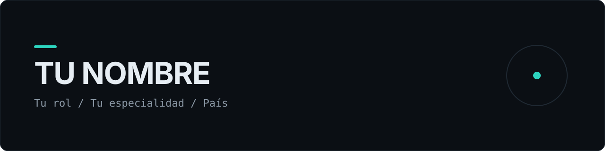

<div align="center">



<p>
  <a href="https://github.com/GersonBarrientos">
    
  </a>
  <a href="https://www.linkedin.com/in/gerson-barrientos">
    
  </a>
  <a href="mailto:gerson.barrientos@oportunidades.org.sv">
    
  </a>
</p>

<p><strong>Texistepeque, Santa Ana, El Salvador</strong></p>

</div>

---

## Acerca de

Soy **Ingeniero en Desarrollo de Software**, comprometido con el desarrollo de nuevos productos dentro de las áreas de backend y frontend. Poseo sólidos conocimientos en diversas plataformas y lenguajes de programación, con un enfoque constante en incrementar mis habilidades técnicas y alcanzar la superación personal.

Me interesa aportar, mejorar y hacer más eficientes los desarrollos del área. Estoy altamente comprometido con los objetivos, el trabajo con metodologías ágiles y la generación de documentación técnica y de usuario.

## Tecnologías

> Esta sección se completará próximamente con las tecnologías y herramientas principales.

## Proyectos

> Esta sección queda reservada para añadir los proyectos destacados, sus tecnologías, enlaces al código y demostraciones.

## Portafolio

> Próximamente: enlace al portafolio personal y una selección de trabajos destacados.

## Cómo trabajo

```text
01  Descubrir       Entiendo el objetivo, el usuario y las restricciones.
02  Diseñar         Propongo una solución simple, medible y mantenible.
03  Construir       Desarrollo por iteraciones con código limpio y probado.
04  Mejorar         Escucho feedback, mido resultados y sigo refinando.
```

## Contacto

Estoy disponible para conectar y conversar sobre oportunidades, proyectos y colaboración profesional.

<div align="center">

<a href="https://www.linkedin.com/in/gerson-barrientos">LinkedIn</a> ·
<a href="mailto:gerson.barrientos@oportunidades.org.sv">Email</a> ·
<a href="https://github.com/GersonBarrientos?tab=repositories">Mis repositorios</a>

<br><br>

<sub>Diseñado y construido con intención · <code>git commit</code> tras <code>git commit</code></sub>

</div>
